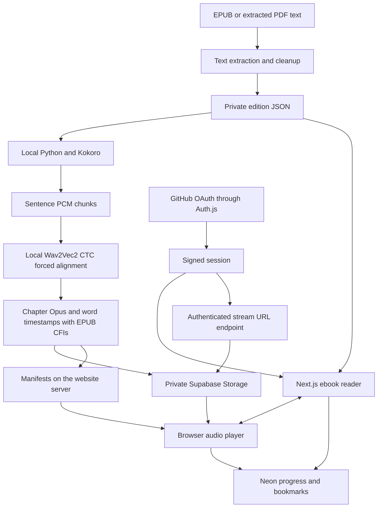

# Readlay architecture

There is no real-time speech endpoint. Next.js has no Python, PyTorch, Kokoro or GPU dependency. Azure AI Speech is not used.

## Content identity

`scripts/import_books.py` writes `.local/books/<bookId>.json`. Each file contains `editionId` and ordered chapters with IDs, titles and paragraph strings. The edition ID covers the source and importer version. Public counts live in `src/data/imported-books.json`; private text stays in server files.

Positions are zero-based `{chapterIndex, paragraphIndex, charOffset}`, scoped to book and edition. `charOffset` counts UTF-16 code units, matching browser selection offsets. Cleaning or replacing an edition invalidates previous coordinates rather than applying them to different text. Older paragraph-only progress resumes at character zero. The additive database migration preserves existing progress and bookmarks.

The preparation command exports a canonical EPUB from the cleaned edition. Its chapter bodies contain paragraph elements with one text node each, allowing stable standard CFIs. `src/lib/epub-location.ts` and the Python exporter use the same spine, paragraph and character coordinates. These CFIs address Readlay's exported edition, not the unmodified publisher EPUB. The private canonical EPUB is retained with local preparation files. The web reader uses the corresponding text coordinates without requiring an EPUB rendering library.

## Audio contract

Preparation writes `.local/audiobooks/<bookId>/<editionId>/<narratorId>/manifest.json`. The version 2 contract in `src/lib/audio-types.ts` contains book, edition, narrator and generation identifiers, explicit chapter coverage, paragraph source hashes, and ordered word cues. Each word carries its original paragraph, UTF-16 start/end offsets, acoustic start/end seconds and canonical EPUB CFI. Chapter audio uses Opus in an Ogg container, served as `audio/ogg`.

The generator narrates sentence chunks at 24 kHz, then analyses their waveforms with a pinned local English CTC acoustic model. Viterbi forced alignment produces word boundaries; durations are not divided proportionally by text length. Low-confidence or unalignable text stops publication. Sentence caches retain audio and alignment by source, voice, model and settings. Chapter PCM is encoded once with FFmpeg, preserving sentence offsets and inserted pauses. Existing verified output is reused. Changed text, narrator or alignment settings deliberately create a new generation.

The acoustic model emits one frame per 20 ms. A timestamp identifies a word within that resolution; it is not a guarantee of a perfect phonetic boundary. Browser seeking also depends on decoder and device behaviour. Spoken number normalisation retains source ranges, with unsupported or ambiguous numeric forms rejected for editorial correction.

Version 1 paragraph MP3 manifests remain readable with their actual precision labelled. They are never promoted to word accuracy. Narrator changes map through text coordinates rather than copying seconds between recordings. A future Singaporean English engine can emit the same word contract.

## Authenticated APIs

| Endpoint | Behaviour |
| --- | --- |
| `/api/auth/*` | Auth.js GitHub OAuth and sessions |
| `GET /api/library` | Current account's progress, saved books and bookmarks |
| `POST /api/library` | Validated, idempotent progress/save/bookmark action |
| `GET /api/dictionary?word=<word>` | Authenticated compatibility lookup when the provider accepts server requests |
| `GET /api/word-bank` | Current account's saved vocabulary and source occurrences |
| `POST /api/word-bank` | Save a source word, change its learning status or remove it |
| `GET /api/audio/<bookId>` | Narrators for the current edition |
| `GET /api/audio/<bookId>?narrator=<id>` | Validated synchronisation manifest |
| `GET /api/audio/<bookId>?narrator=<id>&index=1` | Small chapter index without word timing arrays |
| `GET /api/audio/<bookId>?narrator=<id>&chapter=<index>&v=<generation>` | One chapter's validated timing cues |
| `GET /api/audio/<bookId>/stream?narrator=<id>&chapter=<index>` | Sign-in check and expiring private storage URL |

Audio routes and the reader check the session before opening private files. The server validates chapter IDs, exact paragraph hashes, every source word range, CFI, cue order and object path. Stale or malformed narration is not offered. At most two validated manifests are cached per production process because deployment files are immutable; local preparation stays uncached. The browser requests one chapter's timing arrays and streams from storage after redirection, including byte-range seeking. Private API responses use `no-store`.

The Supabase service key stays on the server. GitHub controls who receives an audio URL; there is no second browser authentication system. Expiring URLs are bearer links and remain usable until expiry. Local preview can use authenticated range streaming with `AUDIO_STORAGE_MODE=local`; Vercel disables this branch.

## Playback and resume

Readers tap a word or select text to open its dictionary. Choosing Set reading place or Listen from here explicitly uses that word as the reading position. A lookup alone does not move the shared position or seek audio. The application cannot infer eye position. Reading to listening seeks to the selected word's acoustic start time. A position inside a word selects that word; whitespace selects the following word, or the final word at paragraph end. Listening to reading finds the current word for `currentTime`, updates the shared position and scrolls to the marked word. Pauses retain the preceding word until the next begins. Optional live highlighting follows the same cues.

Word updates change the reader state immediately. Persistence is debounced during continuous playback and flushed on pause, seek, mode change and page visibility change. Database state is authoritative on sign-in. Account-specific caches and queues prevent another account's library appearing. Progress has word precision across modes and devices; bookmarks remain paragraph-based. Playback speed and reading appearance are device preferences. The six speed settings change native `playbackRate` only.

The player keeps current and next chapter timing data in memory and bounds optional audio prefetch to 2 MiB. Data-saving connections skip that prefetch. Larger chapters still stream normally, so network delays can interrupt a chapter change; preloading is not a guarantee of offline availability.

## Dictionary and Word Bank

The current reader renders cleaned EPUB text directly into the page and scrolls by chapter. It has no EPUB iframe or paginated rendition. `epub-selection.ts` reads ranges from the article's owner document, checks exact lexical word boundaries and records the containing sentence and canonical CFI range. DOM word spans retain their source UTF-16 offsets when fonts or layout change. A future iframe or pagination adapter must supply these same source coordinates and translate its selection rectangle to the outer viewport; there is no claim of testing an iframe renderer that the application does not use.

A tap, native double-click, long-press selection or keyboard selection opens a non-modal contextual dictionary. The normal reader looks up normalised English words directly through [Dictionary API](https://dictionaryapi.dev/), whose API permits browser requests through CORS. Requests omit credentials and referrers and contain only the word, never its sentence, book title, account or reading history. Direct browser requests avoid the provider's HTTP 403 response to the hosted server. The authenticated server lookup remains available for compatible clients where upstream server access works. Exact lookup is tried before conservative inflection fallbacks after a genuine JSON missing-entry response. HTML error pages are not cached as missing words. Lookup errors, missing definitions and missing pronunciation remain explicit. There is no AI definition or speech fallback. Responses retain source and licence attribution. Audio URLs are limited to the dictionary's known HTTPS pronunciation paths.

The shared lookup and parsing modules bound response size, request time, in-flight lookups and caches. The popup uses a small browser cache and cancels obsolete selections; the server compatibility path also supports Next.js fetch revalidation. Separate pronunciation audio never seeks, pauses or replaces audiobook media. The popup tracks its source rectangle on resize and scroll, stays within the viewport, supports Escape and outside dismissal, and does not trap keyboard focus. Numeric source tokens still open the positioning controls without a dictionary request.

Migration `003_word_bank.sql` adds words and source occurrences. A word is unique per authenticated account and resolved dictionary headword. Each occurrence is unique by word, edition, chapter, paragraph and exact start/end offsets. Saving an existing word at another location adds context without resetting its learning status or first saved date. The browser submits the displayed dictionary snapshot. The server checks its bounded structure, headword against the selected word's inflection candidates, definition text and safe media URLs. Definitions are private account data, not independently verified public content. The server derives source spelling, sentence and CFIs from the book, rejecting arbitrary client paths or text. Composite ownership constraints and cascading deletion keep occurrences attached to their account's words.

`WordBankProvider` is separate from reading progress. It uses the existing GitHub session, serialises pulls and mutations, discards responses after account changes and refreshes on focus, reconnection and cross-tab invalidation. Vocabulary and sentences stay in server storage and account-scoped memory; local storage carries only an invalidation marker. Word Bank API responses are private and never cached publicly. The page searches words, definitions and source context, sorts entries, updates New/Learning/Learned status and links back through the stored canonical CFI start coordinates. Saved highlights apply only to recorded occurrences in the matching book edition. Their dotted underline differs from native selection and the current narration marker. Removing a word removes its occurrences and highlights.

## Operations

The Vercel build applies the versioned database migration before Next.js, keeping database credentials in Vercel. Only book JSON and audio manifests are traced into the relevant server functions. Python, model weights and generated audio remain outside deployment.

Generation and upload are operator commands, never production requests. Partial generation records its chapter coverage. Deploy manifests after their immutable Opus objects upload. Supabase is the existing private storage service; no second storage account is required. The uploader reuses matching immutable objects and verifies uploaded hashes. Storage and bandwidth remain subject to the provider's free allowances, even though narration and alignment use no paid API. Local caches have no automatic expiry; retain backups if permanent recovery is required.
