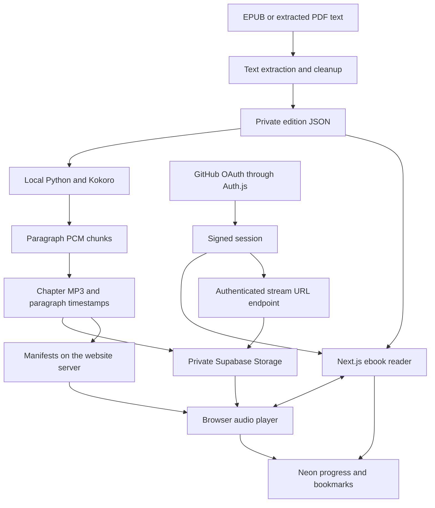

# Readlay architecture

There is no real-time speech endpoint. Next.js has no Python, PyTorch, Kokoro or GPU dependency. Azure AI Speech is not used.

## Content identity

`scripts/import_books.py` writes `.local/books/<bookId>.json`. Each file contains `editionId` and ordered chapters with IDs, titles and paragraph strings. The edition ID covers the source and importer version. Public counts live in `src/data/imported-books.json`; private text stays in server files.

Positions are zero-based `{chapterIndex, paragraphIndex}`, scoped to book and edition. Cleaning or replacing an edition invalidates previous coordinates rather than applying them to different text.

## Audio contract

Preparation writes `.local/audiobooks/<bookId>/<editionId>/<narratorId>/manifest.json`. The version 1 contract in `src/lib/audio-types.ts` includes book, edition, narrator and generation identifiers; narrator name, language, engine and voice; total and prepared chapter coverage; chapter IDs, indices, object paths and durations; and paragraph cues with start/end seconds and SHA-256 hashes of the exact source text.

The generator measures PCM samples at 24 kHz, combines chunks, then encodes a chapter MP3 once. It retains offsets across long-paragraph subchunks and inserted pauses. Future schema versions can carry sentence or word cues. Version 1 claims paragraph alignment only. Narrator changes seek by paragraph, never by copying seconds between voices. A future Singaporean English engine can emit the same contract.

## Authenticated APIs

| Endpoint | Behaviour |
| --- | --- |
| `/api/auth/*` | Auth.js GitHub OAuth and sessions |
| `GET /api/library` | Current account's progress, saved books and bookmarks |
| `POST /api/library` | Validated, idempotent progress/save/bookmark action |
| `GET /api/audio/<bookId>` | Narrators for the current edition |
| `GET /api/audio/<bookId>?narrator=<id>` | Validated synchronisation manifest |
| `GET /api/audio/<bookId>/stream?narrator=<id>&chapter=<index>` | Sign-in check and expiring private storage URL |

Audio routes and the reader check the session before opening private files. The server validates chapter IDs, exact paragraph hashes and object paths. Stale or malformed narration is not offered. The browser streams directly from storage after redirection, including byte-range seeking. Private API responses use `no-store`.

The Supabase service key stays on the server. GitHub controls who receives an audio URL; there is no second browser authentication system. Expiring URLs are bearer links and remain usable until expiry. Local preview can use authenticated range streaming with `AUDIO_STORAGE_MODE=local`; Vercel disables this branch.

## Playback and resume

Reading to listening seeks to the selected cue's `startSeconds`. Listening to reading finds the cue for `currentTime`, updates the shared paragraph and scrolls the ebook. Playback uses the browser audio element, `preload=metadata` and `playbackRate`.

The account provider saves changed paragraphs and retries failed updates. Database state is authoritative on sign-in. Account-specific caches and queues prevent another account's library appearing. Cross-device progress has paragraph precision. Playback speed and reading appearance are device preferences.

## Operations

The Vercel build applies the versioned database migration before Next.js, keeping database credentials in Vercel. Only book JSON and audio manifests are traced into the relevant server functions. Python, model weights and generated audio remain outside deployment.

Generation and upload are operator commands, never production requests. Partial generation records its chapter coverage. Deploy manifests after their immutable MP3 objects upload. Storage and bandwidth can exceed free allowances, even though Kokoro uses no paid speech API.
